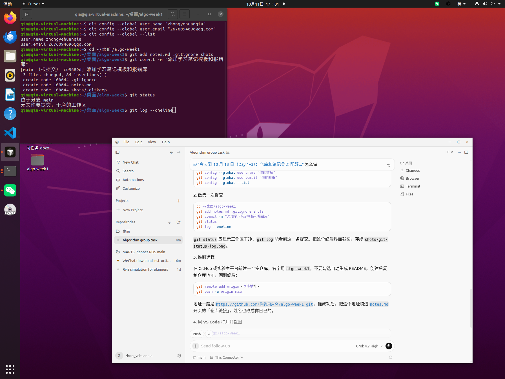
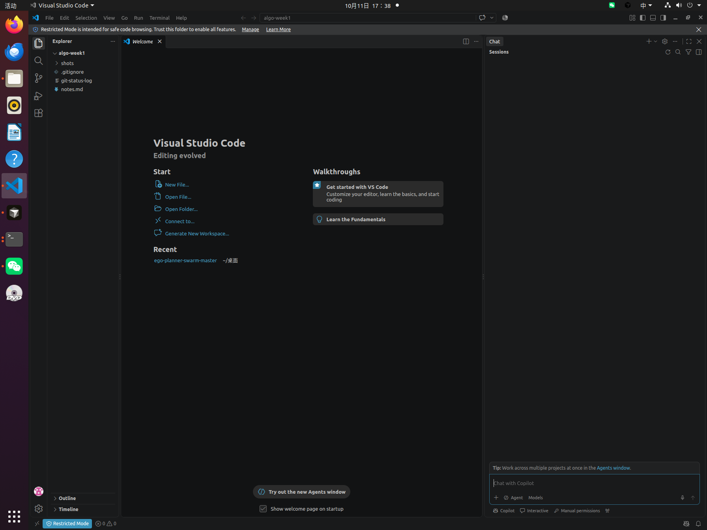
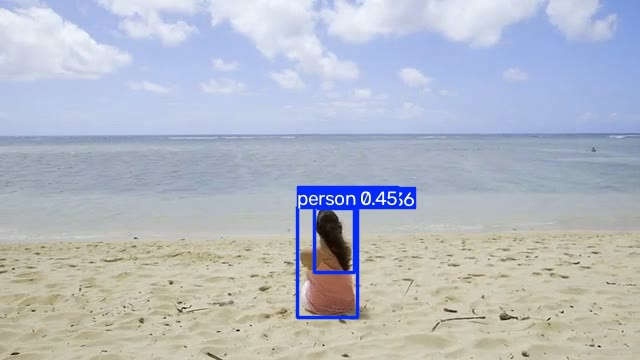

# 算法组第一轮学习笔记

姓名：zhongyehuanqia

日期：2026-10-14（10 月 11 日起）

仓库链接：https://github.com/zhongyehuanqia/algo-week1

环境：Ubuntu 20.04，ROS Noetic，Python 3.8.10。视觉相关命令都在虚拟环境 `~/venvs/yolo` 里运行，Ultralytics 8.4.177。

## 一、任务清单

- 完成了什么
  - [x] 用 VS Code 打开仓库，并配置 Git 姓名和邮箱
  - [x] 建立本地仓库，推到 GitHub，保留提交记录
  - [x] 安装 Ultralytics，用预训练模型 `yolov8n.pt` 检测图片和视频
  - [x] 检测代码写在 `vision/detect.py`，结果截图放在 `shots/`
- 没完成什么
  - [ ] USB 摄像头实时检测。机器上还没有 `/dev/video*`，步骤写在第二节第 6 小节，摄像头到了再做
  - [ ] PX4 250 框架阅读：目录、状态机、通信，以及框架图和问题清单（Day 8–9）

## 二、操作记录

### 1. 配置 Git 并建立仓库

```bash
git config --global user.name "zhongyehuanqia"
git config --global user.email "你的邮箱"
cd ~/桌面/algo-week1
git add notes.md .gitignore shots
git commit -m "添加学习笔记模板和报错库"
git status
git log --oneline
```

第一次提交是 `ce9689d`。当时 `git status` 显示工作区干净，分支是 `main`。



用 VS Code 打开仓库：

```bash
code ~/桌面/algo-week1
```



左侧能看到 `notes.md`、`.gitignore` 和 `shots`。

### 2. 推到 GitHub

```bash
git remote add origin https://github.com/zhongyehuanqia/algo-week1.git
git push -u origin main
```

Username 填 `zhongyehuanqia`。Password 填 Personal Access Token，不是 GitHub 登录密码。Token 在 GitHub → Settings → Developer settings → Personal access tokens → Tokens (classic) 里生成，要勾选 `repo`。生成后只显示一次。

当前远程和本地都在提交 `d2c2e1c`。

### 3. 创建虚拟环境并安装 Ultralytics

系统里原先没有 `pip`，直接 `python3 -m venv` 会因为缺少 `ensurepip` 失败。先装系统包：

```bash
sudo apt update
sudo apt install python3-venv
mkdir -p ~/venvs
python3 -m venv ~/venvs/yolo
source ~/venvs/yolo/bin/activate
python -m pip install -U pip
python -m pip install ultralytics
python -c "import ultralytics; print(ultralytics.__version__)"
```

`sudo` 要输入的是 Ubuntu 登录密码。成功后提示符前面出现 `(yolo)`，版本号打印为 `8.4.177`。新开的终端都要重新 `source ~/venvs/yolo/bin/activate`。

### 4. 用图片跑预训练检测

```bash
source ~/venvs/yolo/bin/activate
cd ~/桌面/algo-week1/vision
yolo predict model=yolov8n.pt source='https://ultralytics.com/images/bus.jpg'
cp runs/detect/predict/bus.jpg ~/桌面/algo-week1/shots/yolo-bus.jpg
```

第一次运行会下载权重 `yolov8n.pt`。结果图里公交车和行人都被框出来了。


### 5. 用视频跑检测代码

检测脚本是 `vision/detect.py`，示例视频是 `vision/sample.mp4`（约 400 帧）。权重和视频不放进 Git。

```bash
source ~/venvs/yolo/bin/activate
cd ~/桌面/algo-week1/vision
python detect.py --source sample.mp4
```

带框的视频在 `vision/runs/detect/predict-2/sample.avi`。终端每一帧会打印类别，例如 `1 person`。下面是其中一帧。



### 6. 后续：USB 摄像头实时检测

摄像头插上后再做。先确认设备，再把输入从视频文件改成摄像头编号 `0`。

```bash
ls /dev/video*
source ~/venvs/yolo/bin/activate
cd ~/桌面/algo-week1/vision
python detect.py --source 0
```

画面里应出现实时检测框。结束时在终端按 Ctrl+C。截一张带框的画面，保存为 `shots/yolo-camera.jpg`，再补到本节下面。

- [ ] `/dev/video*` 存在
- [ ] `python detect.py --source 0` 能实时出框
- [ ] 截图保存到 `shots/yolo-camera.jpg`

## 三、报错库

| 日期 | 模块 | 报错/现象 | 原因 | 解决 | 参考 |
| --- | --- | --- | --- | --- | --- |
| 2026-10-11 | Git | `Permission to zhongyehuanqia/algo-week1.git denied to zhongyehuanqia`，HTTPS 返回 403 | 用来推送的 Token 没有仓库写入权限 | 重新生成 Classic Token 并勾选 `repo`，在 `git push` 的 Password 提示里粘贴这串 Token | https://github.com/zhongyehuanqia/algo-week1 |
| 2026-10-14 | Python | `python3 -m venv` 失败，提示 `ensurepip is not available` | 系统没装 `python3-venv` | `sudo apt install python3-venv` 之后重新创建 `~/venvs/yolo` | Ubuntu 20.04 / Python 3.8 |

## 四、代码/文件

| 文件路径 | 作用说明 |
| --- | --- |
| `notes.md` | 学习笔记，最后整份交到飞书 |
| `shots/` | 操作截图和检测结果图 |
| `vision/detect.py` | 加载 `yolov8n.pt`，对图片、视频或摄像头做检测，结果写到 `runs/detect/` |
| `vision/yolov8n.pt` | 预训练权重。体积较大，已在 `.gitignore` 里，只留在本机 |
| `vision/sample.mp4` | 没有摄像头时用来跑检测的示例视频，不提交到 Git |
| `vision/bus.jpg` | 图片检测用的输入图，不提交到 Git |
| `vision/runs/` | Ultralytics 自动生成的检测结果，不提交到 Git |
| `~/venvs/yolo` | 虚拟环境，不放进仓库 |

`detect.py` 的用法：

```bash
python detect.py --source bus.jpg
python detect.py --source sample.mp4
python detect.py --source 0
```

## 五、小结与疑问

- 学到了什么
  - Git 的一次完整流程是配置身份、`git add`、`git commit`、`git push`。`git status` 看未提交的改动，`git log` 看提交记录。
  - 推送到 GitHub 时，Password 要填勾选了 `repo` 的 Token。Token 只在生成时显示一次，丢了就重新生成。
  - 视觉环境单独放在 `~/venvs/yolo`，避免和系统 Python 混在一起。进入环境后提示符前面有 `(yolo)`。
  - `yolov8n.pt` 是现成的预训练权重。图片和视频都能检出人；图片里还检出了公交车。
- 还没懂什么
  - Token 过期之后，本机如果记住了旧 Token，要在哪里清掉再换新的。
  - 摄像头编号为什么是 `0`，插上两个摄像头时怎么区分。
  - PX4 250 的目录、状态机和通信文件还没开始看。
