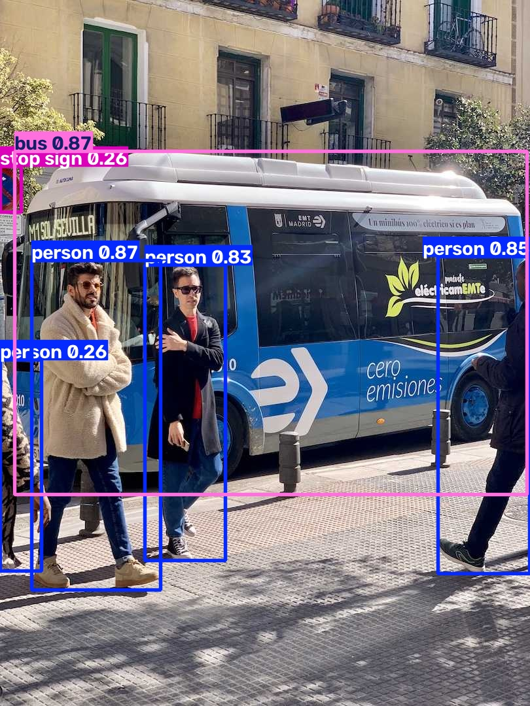
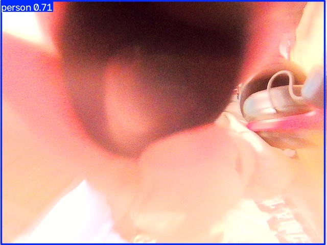
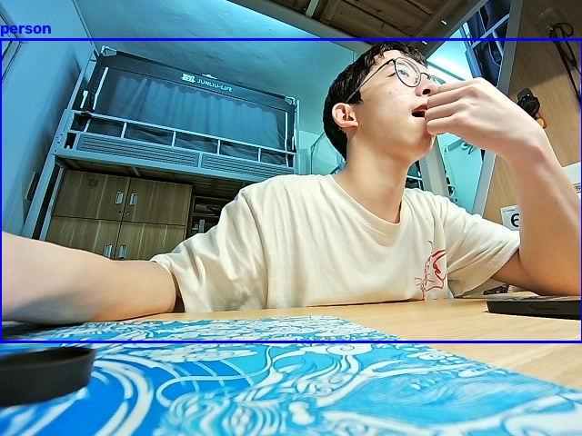
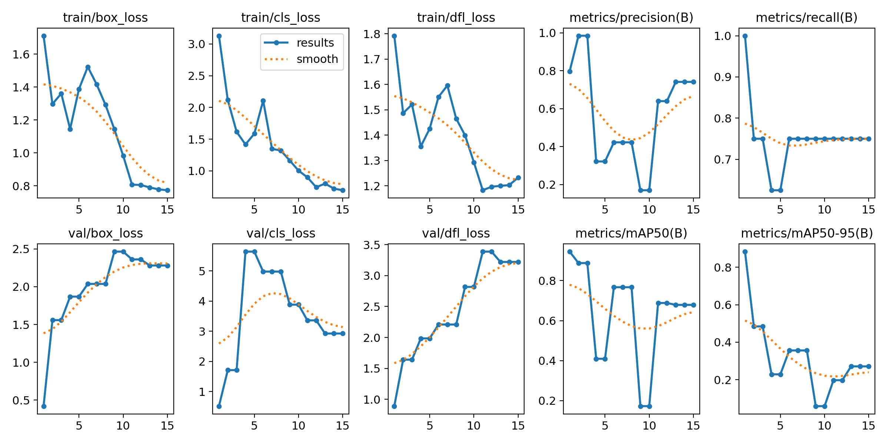

# 学习笔记：Git、YOLO 和 PX4

姓名：zhongyehuanqia

日期：2026-10-14（10 月 11 日起）

仓库链接：https://github.com/zhongyehuanqia/algo-week1

环境：Ubuntu 20.04，ROS Noetic，Python 3.8.10。视觉相关命令都在虚拟环境 `~/venvs/yolo` 里运行，Ultralytics 8.4.177。

## 一、任务清单

- 完成了什么
  - [x] 用 VS Code 打开仓库，并配置 Git 姓名和邮箱
  - [x] 建立本地仓库，推到 GitHub，保留提交记录
  - [x] 安装 Ultralytics，用预训练模型 `yolov8n.pt` 检测图片和视频
  - [x] 检测代码写在 `yolo检测/detect.py`，结果截图放在 `yolo检测/截图/`
- 完成了什么（续）
  - [x] PX4 250 框架初读。源码在 `/home/qia/PX4-Autopilot`，框架图和问题清单在 `px4/framework.md`
  - [x] USB 摄像头实时检测。设备是 `/dev/video0`，结果在 `yolo检测/截图/yolo-camera.jpg`
  - [x] Day 10–11 概念整理和一次训练都做了。30 张来自 USB 摄像头，训练曲线在 `yolo检测/截图/yolo-train.png`
  - [x] 三分钟讲解稿在第二节第 9 小节。飞书仍需自己把这份笔记贴上去
- 没完成什么
  - 框是预训练模型自动标的，不是手动画的。如果验收要求手标，需要再改 `yolo检测/dataset/labels/`。

## 二、操作记录

### 1. 配置 Git 并建立仓库

```bash
git config --global user.name "zhongyehuanqia"
git config --global user.email "你的邮箱"
cd ~/桌面/ros-px4-vision
git add notes.md .gitignore shots
git commit -m "添加学习笔记模板和报错库"
git status
git log --oneline
```

第一次提交是 `ce9689d`。当时 `git status` 显示工作区干净，分支是 `main`。


用 VS Code 打开仓库：

```bash
code ~/桌面/ros-px4-vision
```


左侧能看到 `notes.md`、`.gitignore` 和 `shots`。

### 2. 推到 GitHub

```bash
git remote add origin https://github.com/zhongyehuanqia/algo-week1.git
git push -u origin main
```

Username 填 `zhongyehuanqia`。Password 填 Personal Access Token，不是 GitHub 登录密码。Token 在 GitHub → Settings → Developer settings → Personal access tokens → Tokens (classic) 里生成，要勾选 `repo`。生成后只显示一次。

当前远程和本地都在提交 `d2c2e1c`。

### 3. 创建虚拟环境并安装 Ultralytics

系统里原先没有 `pip`，直接 `python3 -m venv` 会因为缺少 `ensurepip` 失败。先装系统包：

```bash
sudo apt update
sudo apt install python3-venv
mkdir -p ~/venvs
python3 -m venv ~/venvs/yolo
source ~/venvs/yolo/bin/activate
python -m pip install -U pip
python -m pip install ultralytics
python -c "import ultralytics; print(ultralytics.__version__)"
```

`sudo` 要输入的是 Ubuntu 登录密码。成功后提示符前面出现 `(yolo)`，版本号打印为 `8.4.177`。新开的终端都要重新 `source ~/venvs/yolo/bin/activate`。

### 4. 用图片跑预训练检测

```bash
source ~/venvs/yolo/bin/activate
cd ~/桌面/ros-px4-vision/yolo检测
yolo predict model=yolov8n.pt source='https://ultralytics.com/images/bus.jpg'
cp runs/detect/predict/bus.jpg ~/桌面/ros-px4-vision/yolo检测/截图/yolo-bus.jpg
```

第一次运行会下载权重 `yolov8n.pt`。结果图里公交车和行人都被框出来了。



### 5. 用视频跑检测代码

检测脚本是 `yolo检测/detect.py`，示例视频是 `yolo检测/sample.mp4`（约 400 帧）。权重和视频不放进 Git。

```bash
source ~/venvs/yolo/bin/activate
cd ~/桌面/ros-px4-vision/yolo检测
python detect.py --source sample.mp4
```

带框的视频在 `yolo检测/runs/detect/predict-2/sample.avi`。终端每一帧会打印类别，例如 `1 person`。下面是其中一帧。


### 6. USB 摄像头实时检测

2026-10-15 外接 USB 摄像头已连进虚拟机。`lsusb` 里是 Realtek RGB Camera（`0bda:5161`），设备节点是 `/dev/video0` 和 `/dev/video1`。笔记本自带的 Syntek Integrated Camera 已断开，检测用的是这颗 RGB Camera 的 `/dev/video0`。

```bash
ls /dev/video*
source ~/venvs/yolo/bin/activate
cd ~/桌面/ros-px4-vision/yolo检测
python detect.py --source 0
```

`detect.py` 会用 MJPG、640x480 打开摄像头。窗口里按 `q` 退出，稳定后的第一帧存到 `yolo检测/截图/yolo-camera.jpg`。

把虚拟机的 USB 控制器改成 USB 3.0，并改连这颗 RGB Camera 之后，画面正常。检出 person 0.87 和 dining table 0.31。



- [x] `/dev/video0` 存在
- [x] 画面正常，并且能出检测框
- [x] 截图保存到 `yolo检测/截图/yolo-camera.jpg`

### 7. PX4 250 框架初读

本机原来没有飞控源码，只浅克隆了官方主仓库，没有拉取子模块：

```bash
git clone --depth 1 --single-branch --branch main https://github.com/PX4/PX4-Autopilot.git ~/PX4-Autopilot
```

阅读提交是 `49b856b5`。框架图、目录、状态机位置、通信位置和问题清单写在 `px4/framework.md`。

三句话能讲清楚：

- 目录主体在 `src/modules`、`src/drivers`、`msg`、`ROMFS`。
- 状态机在 `src/modules/commander/`，解锁看 `arming_state`，飞行模式看 `nav_state`。
- 对外通信在 `src/modules/mavlink/`，模块之间用 `platforms/common/uORB` 和 `msg/`。
- 250 是机架参数：`ROMFS/px4fmu_common/init.d/airframes/4050_generic_250` 和 `4052_holybro_qav250`。

### 8. YOLO 概念整理

概念和训练都做了。下面这些词对应已经跑过的 `yolov8n.pt`，训练用的是 USB 摄像头新拍的 30 张。

预训练和自己训练：

- `yolov8n.pt` 是别人用大型数据集训练好的权重。`n` 表示 nano，模型小、速度快，适合先跑通。
- 直接 `predict` 就是用现成权重做检测。图片里的 bus、person，视频里的 person，摄像头里的 person 和 dining table，都是这套权重认出来的。
- 自己训练是换一批自己拍的图，标好框，再从预训练权重继续学。这次用 Realtek RGB Camera 拍了 30 张，其中 24 张训练、6 张验证。框由预训练模型自动标出 `person`，类别编号写成 0。照片留在本机 `yolo检测/dataset/`，不放进 Git。

一次检测里发生的事：

- 输入是一张图，或视频、摄像头里的一帧。代码里就是 `model.predict(...)`。
- 模型输出很多候选框。每个框有类别名和置信度，例如 `person 0.87`。置信度越高，模型越肯定。
- 同一物体常会得到多个重叠框。NMS（非极大值抑制）留下置信度更高的框，去掉重叠的多余框。画面上最后看到的框，是 NMS 之后的结果。
- `save=True` 或 `result.plot()` 把这些框画回原图。

和这次代码的对应关系：

| 概念 | 在本仓库里 |
| --- | --- |
| 预训练权重 | `yolo检测/yolov8n.pt` |
| 检测入口 | `yolo检测/detect.py` 里的 `model.predict` |
| 图片结果 | `yolo检测/截图/yolo-bus.jpg` |
| 视频结果 | `yolo检测/截图/yolo-video.jpg` |
| 摄像头结果 | `yolo检测/截图/yolo-camera.jpg` |
| 自动标注预览 | `yolo检测/截图/yolo-label-preview.jpg` |
| 训练曲线 | `yolo检测/截图/yolo-train.png` |

训练命令：

```bash
source ~/venvs/yolo/bin/activate
cd ~/桌面/ros-px4-vision/yolo检测
yolo detect train model=yolov8n.pt data=dataset/data.yaml epochs=15 imgsz=320 batch=8 device=cpu project=runs name=person-train exist_ok=True
```

15 个 epoch 在 CPU 上跑完。最好的一轮在 6 张验证图、8 个 person 框上是 precision 0.797、recall 1.0、mAP50 0.945。张数很少，而且框来自同一个预训练模型，这个数只说明训练流程跑通了。

自动标注示例：



训练曲线：



新权重在 `yolo检测/runs/detect/runs/person-train/weights/best.pt`，已忽略、不提交。

### 9. 三分钟讲解稿

验收时按这个顺序讲，大约三分钟。

1. 仓库在 https://github.com/zhongyehuanqia/algo-week1 。里面有笔记、`yolo检测/detect.py`、三张检测截图，以及 `px4/framework.md`。
2. 检测：先建虚拟环境 `~/venvs/yolo`，安装 Ultralytics，用 `yolov8n.pt`。图片检出公交车和行人，视频检出人，USB 摄像头是 Realtek RGB Camera 的 `/dev/video0`，检出 person 0.87。
3. 报过错：推送 403 是 Token 没有 `repo` 权限；创建虚拟环境缺 `python3-venv`；摄像头第一次接成了笔记本自带相机，而且旧 USB 控制器把画面传花了。
4. PX4：状态机在 `src/modules/commander/`，看 `arming_state` 和 `nav_state`。对外通信在 `src/modules/mavlink/`，模块之间用 uORB。250 是机架文件 `4050_generic_250`。
5. 训练：USB 摄像头拍了 30 张，预训练模型自动标了 person，训练 15 个 epoch。曲线在 `yolo检测/截图/yolo-train.png`。框不是手画的。还没看完的是解锁命令怎样从 MAVLink 走进 commander。

飞书提交：把本文件全文复制到飞书文档，图片用 `yolo检测/截图/` 和 `笔记/截图/` 里的截图。

## 三、报错库

| 日期 | 模块 | 报错/现象 | 原因 | 解决 | 参考 |
| --- | --- | --- | --- | --- | --- |
| 2026-10-11 | Git | `Permission to zhongyehuanqia/algo-week1.git denied to zhongyehuanqia`，HTTPS 返回 403 | 用来推送的 Token 没有仓库写入权限 | 重新生成 Classic Token 并勾选 `repo`，在 `git push` 的 Password 提示里粘贴这串 Token | https://github.com/zhongyehuanqia/algo-week1 |
| 2026-10-14 | Python | `python3 -m venv` 失败，提示 `ensurepip is not available` | 系统没装 `python3-venv` | `sudo apt install python3-venv` 之后重新创建 `~/venvs/yolo` | Ubuntu 20.04 / Python 3.8 |
| 2026-10-15 | 摄像头 | 第一次连上的是笔记本自带 Syntek 摄像头；旧 USB 控制器下画面还是横条 | 可移动设备里接错了摄像头，且旧控制器损坏 MJPEG | 改成 USB 3.0 控制器，断开 Syntek，连接 Realtek RGB Camera（`0bda:5161`）后再检测 | `/dev/video0` |

## 四、代码/文件

| 文件路径 | 作用说明 |
| --- | --- |
| `notes.md` | 学习笔记，最后整份交到飞书 |
| `笔记/截图/` | Git 和 VS Code 截图 |
| `yolo检测/截图/` | YOLO 检测结果图 |
| `yolo检测/detect.py` | 加载 `yolov8n.pt`，对图片、视频或摄像头做检测，结果写到 `runs/detect/` |
| `yolo检测/yolov8n.pt` | 预训练权重。体积较大，已在 `.gitignore` 里，只留在本机 |
| `yolo检测/sample.mp4` | 没有摄像头时用来跑检测的示例视频，不提交到 Git |
| `yolo检测/bus.jpg` | 图片检测用的输入图，不提交到 Git |
| `yolo检测/runs/` | Ultralytics 自动生成的检测结果，不提交到 Git |
| `~/venvs/yolo` | 虚拟环境，不放进仓库 |
| `px4/framework.md` | PX4 250 的目录、状态机、通信和问题清单 |
| `notes.md` 第八、九节 | YOLO 概念、训练记录，以及三分钟验收讲解稿 |
| `yolo检测/dataset/data.yaml` | 训练用的数据配置。图片和标注留在本机，不提交 |
| `~/PX4-Autopilot` | PX4 固件源码，体积大，不放进本仓库 |

`detect.py` 的用法：

```bash
python detect.py --source bus.jpg
python detect.py --source sample.mp4
python detect.py --source 0
```

## 五、小结与疑问

- 学到了什么
  - Git 的一次完整流程是配置身份、`git add`、`git commit`、`git push`。`git status` 看未提交的改动，`git log` 看提交记录。
  - 推送到 GitHub 时，Password 要填勾选了 `repo` 的 Token。Token 只在生成时显示一次，丢了就重新生成。
  - 视觉环境单独放在 `~/venvs/yolo`，避免和系统 Python 混在一起。进入环境后提示符前面有 `(yolo)`。
  - `yolov8n.pt` 是现成的预训练权重。图片检出公交车和行人，视频和 USB 摄像头都检出了人。
  - PX4 的状态机在 `src/modules/commander/`，对外通信在 `src/modules/mavlink/`，模块之间用 uORB。250 是机架参数文件，不是另一套代码。
  - 预训练权重可以直接检测。置信度表示模型有多确定，重叠的多余框会被 NMS 去掉。自己训练需要另外准备标好框的图片。
- 还没懂什么
  - Token 过期之后，本机如果记住了旧 Token，要在哪里清掉再换新的。
  - 摄像头编号为什么是 `0`，插上两个摄像头时怎么区分。
  - `arming_state` 和 `nav_state` 的具体取值还没逐个对过。
  - 地面站的解锁命令怎样一步步进到 commander，还没顺着函数看完。
