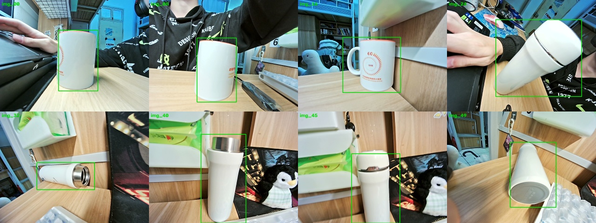
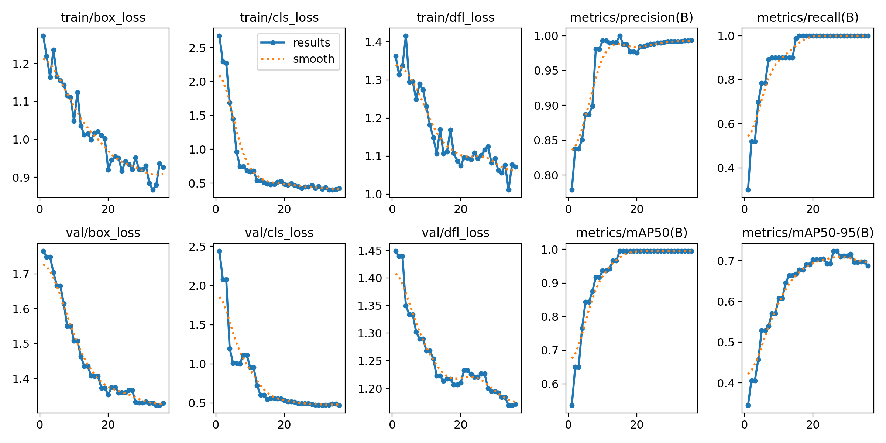
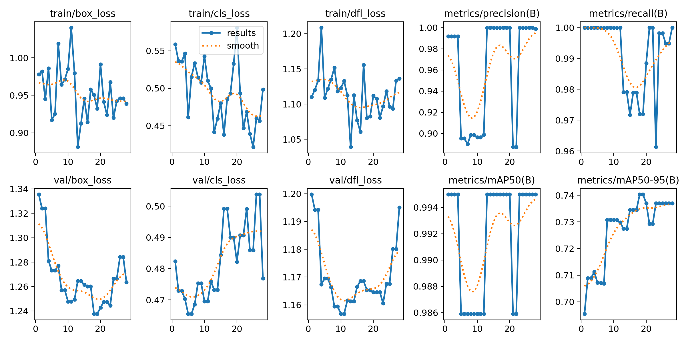
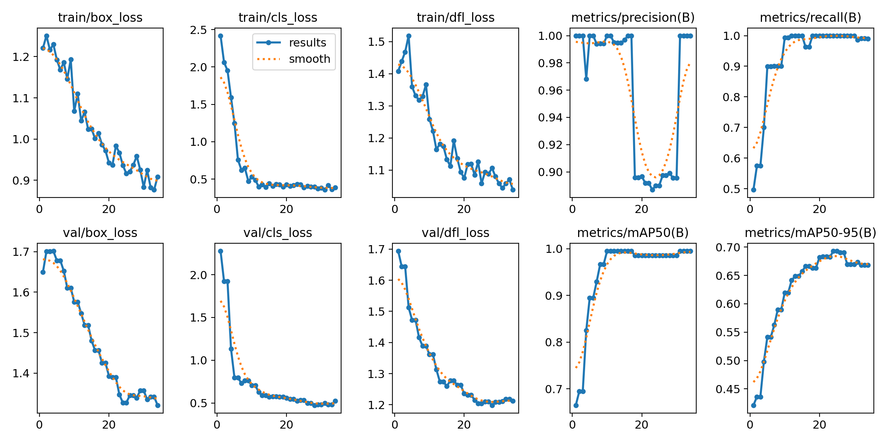
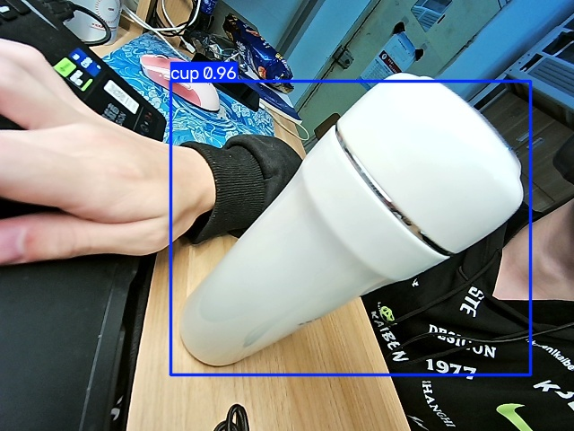
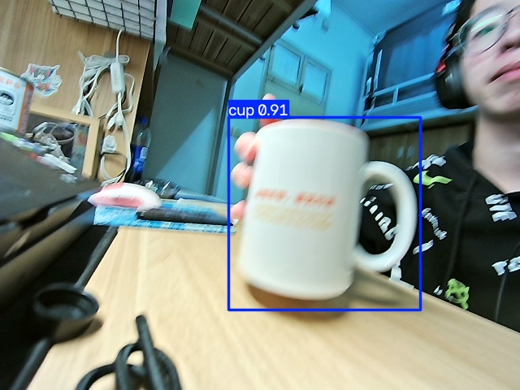

# 算法组第二轮验收笔记

姓名：zhongyehuanqia

日期：2026-11-02

环境：Ubuntu 20.04，ROS Noetic，Python 3.8.10，虚拟环境 `~/venvs/yolo`，Ultralytics 8.4.177。训练在 CPU 上跑（Intel Core i7-14650HX，没有 CUDA）。

飞书粘贴正文后，按下面顺序插入图片。本地路径飞书不会自动显示。

1. `yolo/yolo检测/截图/cup-dataset.jpg`
2. `yolo/yolo检测/截图/cup-n-stable.png`
3. `yolo/yolo检测/截图/cup-n-finetune.png`
4. `yolo/yolo检测/截图/cup-s-stable.png`
5. `yolo/yolo检测/截图/cup-detect.jpg`
6. `yolo/yolo检测/截图/cup-camera.jpg`

## 一、任务完成进度

- [x] 选定识别目标：水杯，类别名 `cup`。USB 摄像头实拍 50 张
- [x] 用 labelImg 画框。保存时格式是 JSON，已转成 YOLO 的 txt，和照片放在同一目录
- [x] 划分数据集：训练 39 张，验证 10 张，另留 1 张不参与训练
- [x] 改 `data.yaml`，用 SGD 训练。n 先用学习率 0.001、冻住前 10 层，再从这份 best 用学习率 0.0001 放开全部层。s 用和第一轮相同的小学习率对比
- [x] 记录 n 和 s 的 mAP、训练时间和推理速度
- [x] 用自己的 `cup/best.pt` 做检测。测试图置信度 0.96，摄像头实时画面置信度 0.91
- [x] 读本机 `MARTS-Planner-ROS-main/px4ctrl`，整理它收什么、发什么、怎么连到飞控
- [x] 整理视觉坐标在 ROS 里用什么消息，以及串口波特率和校验位
- [ ] 飞书文档：把本文件贴进飞书，并按上面的顺序上传 6 张图

降落靶是更早的贴图练习，数据和权重在 `yolo/yolo检测/pad/`，和这次水杯分开。验收演示用水杯。

## 二、视觉训练记录

识别目标是水杯。照片用 Realtek RGB Camera（`/dev/video0`）拍摄，保存在 `yolo/yolo检测/cup/raw/`。配置在 `yolo/yolo检测/cup/dataset/data.yaml`，类别只有 `cup`。

官方 `yolov8n.pt` 的 COCO 类别里已经有 `cup`。这次训练是用自己拍的杯子接着学，检测时加载的是 `cup/best.pt`，不是官方权重。

标注预览（绿框是转成 YOLO 之后的框）：



三轮都是输入 416、batch 4、CPU、关掉 Mosaic、优化器固定为 SGD。验证集 mAP50-95 连续 10 轮没有变高就停止，`best.pt` 只保留最高的那一轮。

| 实验 | 模型 | 做法 | 权重 |
| --- | --- | --- | --- |
| `n-stable` | YOLOv8n | 学习率 0.001，冻住前 10 层 | `cup/runs/n-stable/weights/best.pt` |
| `n-finetune` | YOLOv8n | 从上一轮的 best 继续，学习率 0.0001，放开全部层 | `cup/runs/n-finetune/weights/best.pt` |
| `s-stable` | YOLOv8s | 和学习率、冻结相同，只换模型 | `cup/runs/s-stable/weights/best.pt` |

n，学习率 0.001，冻住前 10 层：



n，从上面的 best 继续，学习率 0.0001：



s，学习率 0.001，冻住前 10 层：



没参与训练的测试图：



摄像头实时画面，置信度 0.91：



### 指标

验证集 10 张。mAP 取 `results.csv` 里 mAP50-95 最高的一轮。推理速度是同一张测试图、输入 416、CPU 上先空跑 3 帧，再对后面 20 帧取平均。

| 实验 | 训练耗时 | 最好一轮 | mAP50 | mAP50-95 | 推理 |
| --- | --- | --- | --- | --- | --- |
| n，学习率 0.001，冻住前 10 层 | 169 秒，跑了 36 轮 | 第 26 轮 | 0.995 | 0.724 | 和下面的 n 是同一个模型大小 |
| n，学习率 0.0001，放开全部层 | 179 秒，跑了 28 轮 | 第 18 轮 | 0.995 | 0.740 | 61 毫秒，16.5 FPS |
| s，学习率 0.001，冻住前 10 层 | 387 秒，跑了 34 轮 | 第 24 轮 | 0.986 | 0.693 | 120 毫秒，8.3 FPS |

测试图上，n 微调权重框出 1 个 cup，置信度 0.96。s 也是 1 个 cup，置信度 0.98。摄像头实拍截图用的是 n 微调权重，置信度 0.91。三轮里 mAP50-95 最高的是 n 微调，已复制到 `cup/best.pt`。

### 哪一个更适合这台电脑

1. 同一套小学习率和冻结设置下，n 的 mAP50-95 是 0.724，放开后微调到 0.740；s 是 0.693，更大的模型在这 39 张图上没有更高。
2. 这台机器没有 CUDA。n 大约 61 毫秒一帧，s 大约 120 毫秒，训练时间也从 179 秒变成 387 秒。
3. 演示用水杯的 n 微调权重 `yolo/yolo检测/cup/best.pt`。

复现命令：

```bash
source ~/venvs/yolo/bin/activate
cd ~/桌面/ros-px4-vision/yolo/yolo检测/cup
python capture.py
labelImg raw raw/classes.txt
python split_real.py
python train_cup.py
python detect_cup.py --source 0
```

## 三、报错库

| 日期 | 模块 | 现象 | 原因 | 解决 | 以后怎么避免 |
| --- | --- | --- | --- | --- | --- |
| 2026-10-11 | Git | 推送 403，`Permission denied` | Token 没有仓库写入权限 | 重新生成 Classic Token，勾选 `repo`，在 Password 提示里粘贴 | 生成 Token 时先勾 `repo`。Token 只显示一次，立刻放进密码管理器，不要写进笔记或代码 |
| 2026-10-14 | Python | `python3 -m venv` 报 `ensurepip is not available` | 系统没装 `python3-venv` | `sudo apt install python3-venv` 后重建 `~/venvs/yolo` | 新机器先装 `python3-venv` 再创建虚拟环境。视觉命令都在这个环境里跑 |
| 2026-10-15 | 摄像头 | 画面是横条，或者接到了笔记本自带相机 | 虚拟机接错了 USB 设备，旧 USB 控制器把 MJPEG 传坏了 | 连接 Realtek RGB Camera（`0bda:5161`），用 `/dev/video0` | 检测前先 `lsusb` 和 `ls /dev/video*`，确认节点是 RGB Camera |
| 2026-10-28 | 训练 | 日志写 `ignoring lr0`，两次学习率看起来没差别 | Ultralytics 8.4 在 `optimizer=auto` 时自己选学习率，传入的 `lr0` 不生效 | `train_pad.py` 和 `train_cup.py` 里写明 `optimizer="SGD"` | 先看日志里的 `SGD(lr=...)`。出现 ignoring，就停掉重跑 |
| 2026-11-02 | 摄像头 | 强制 MJPG 时右半边或整幅都是横条 | 当前虚拟机的 USB 通道传 MJPEG 会花 | 拍照和检测都改用摄像头默认格式，不再 `set` MJPG | 开拍前先存一张看有没有横条。有横条就不要用 MJPG |
| 2026-11-02 | 标注 | 终端提示 `labelImg` 未找到命令 | 程序没装在系统里，只装在 `~/venvs/yolo`，而且 `I` 是大写 | `source ~/venvs/yolo/bin/activate` 后再运行 `labelImg` | 视觉相关命令都先进入这个虚拟环境 |
| 2026-11-02 | 标注 | 画完框没有和照片同名的 txt | labelImg 当时保存的是 JSON，不是 YOLO | 按框的中心和宽高转成 YOLO txt，放到 `cup/raw/` | 开标前先确认左侧按钮是 `YOLO`。出现 `.json` 就说明格式还没改 |
| 2026-10-15 | 训练 | 上一轮 person 的验证定位损失越训越高 | 30 张几乎同一场景，学习率 0.01，框还是模型自动标的 | 水杯换成实拍，学习率用 0.001，连续 10 轮没有提升就停 | 验证集不要从同一段连拍里抽。损失升了就停，演示用 `best.pt`，不用最后一轮的 `last.pt` |

## 四、机载节点：px4ctrl 做什么，怎么连到飞控

本机没有单独克隆 Fast-Drone-250 仓库。桌面上的 `MARTS-Planner-ROS-main/px4ctrl` 就是这套机载控制器，入口、状态机和发给 MAVROS 的方式与 Fast-Drone-250 的 px4ctrl 是同一条链路。验收时打开这份代码讲。和上游原版有两处不一样，讲的时候要按打开的文件说：原版规划话题常见是 `/planning/pos_cmd`，消息是 `quadrotor_msgs/PositionCommand`，切模式写 `OFFBOARD`；这份 launch 把 `~cmd` 映到 `/position_cmd`，消息是 `PositionCommandNew`，`toggle_offboard_mode()` 里写的模式名是 `GUIDED_NOGPS`。

px4ctrl 不负责认图，也不规划轨迹。它站在规划器和飞控中间：把“要飞到哪”换成飞控能执行的姿态和油门，并负责切模式、解锁。

### 数据流向

```text
规划器
  发布 /position_cmd
  类型 quadrotor_msgs/PositionCommandNew
  内容是位置、速度、加速度、yaw（米和弧度，不是像素）
        |
        v
px4ctrl_node
  还订阅：
    /ekf/ekf_odom          nav_msgs/Odometry     当前位置和速度（launch 里从 ~odom 映过来）
    /mavros/imu/data_raw   sensor_msgs/Imu       角速度和加速度
    /mavros/state          mavros_msgs/State     是否连上、当前模式、是否解锁
    /mavros/extended_state mavros_msgs/ExtendedState
    /mavros/rc/in          mavros_msgs/RCIn      遥控器，决定能不能接管
    /mavros/battery        sensor_msgs/BatteryState
    takeoff_land           quadrotor_msgs/TakeoffLand   1 起飞，2 降落
        |
        |  controller 用期望位置和当前里程计算出
        |  四元数、机体角速度、油门
        v
  发布 /mavros/setpoint_raw/attitude
  类型 mavros_msgs/AttitudeTarget
  服务：
    /mavros/set_mode       切 GUIDED_NOGPS
    /mavros/cmd/arming     解锁或上锁
    /mavros/cmd/command    重启飞控（MAVLink 命令 246）
        |
        v
MAVROS
  把 ROS 消息打成 MAVLink，经串口发给飞控
        |
        v
飞控里的 mavlink 模块
  收包后写成 uORB
  commander 管解锁和模式
  姿态控制、角速度控制去跟踪这条 AttitudeTarget
```

对应代码：

| 做什么 | 文件 |
| --- | --- |
| 订阅和发布在节点入口 | `px4ctrl/src/px4ctrl_node.cpp` |
| 话题重映射 | `px4ctrl/launch/run_ctrl.launch`，`~odom` → `/ekf/ekf_odom`，`~cmd` → `/position_cmd` |
| 收到的字段放进什么结构 | `px4ctrl/include/px4ctrl/input.h` |
| 状态机 | `px4ctrl/include/px4ctrl/PX4CtrlFSM.h` |
| 把姿态发出去、切模式、解锁 | `px4ctrl/src/PX4CtrlFSM.cpp` 里的 `publish_attitude_ctrl`、`toggle_offboard_mode`、`toggle_arm_disarm` |

状态机五个状态：

| 状态 | 作用 |
| --- | --- |
| `MANUAL_CTRL` | px4ctrl 不接管，飞机只听遥控器 |
| `AUTO_HOVER` | 已经接管，按里程计悬停，等位置指令 |
| `CMD_CTRL` | 正在跟踪规划器发来的位置指令 |
| `AUTO_TAKEOFF` | 自动起飞 |
| `AUTO_LAND` | 自动降落 |

`publish_attitude_ctrl` 把 `type_mask` 设成忽略角速度，只发四元数和油门。油门字段是 `msg.thrust`。这条消息进 MAVROS 之后，才变成飞控上的姿态设定值。px4ctrl 自己不写电机 PWM。

## 五、通信和消息格式

这部分不写新的通信代码。视觉结果以后要进控制节点，中间要换一次消息。

像素坐标和飞控要的位置不是同一种消息。

| 场合 | ROS 消息 | 里面是什么 |
| --- | --- | --- |
| 检测框还在图像上 | `vision_msgs/Detection2DArray` | 框的中心和宽高，单位是像素 |
| 本仓库现在的例子 | `detect_demo/Detect`（`label`、`cx`、`cy`） | 类别和像素中心 |
| 已经换成空间位置 | `geometry_msgs/PoseStamped` | 在某个坐标系下的位置，单位是米 |
| 专门告诉飞控降落点 | `mavros_msgs/LandingTarget` | 对应 MAVLink 的 `LANDING_TARGET` |
| 规划器交给 px4ctrl | `quadrotor_msgs/PositionCommandNew` | 位置、速度、加速度、yaw |

视觉节点先发像素。要让飞机动，还得用相机内参，加上高度或深度，把 `(cx, cy)` 换成米，再交给规划器。px4ctrl 不订阅检测框。

串口里和这次相关的两个词：

波特率是双方约好的传输速度，单位可以理解成比特每秒。两边必须相同，否则字节边界对不齐，日志里就是乱码。USB 直接连飞控时常见 921600。无线数传常见 57600 或 115200。改一边、忘了改另一边，是连不上时最先查的一项。

校验位是数据位后面可选的一位，用来发现这一帧里有没有奇数个比特翻转。偶校验让“数据位加校验位”里 1 的个数是偶数，奇校验则是奇数。不加校验位时记成 N。平时说的 8N1，是 8 个数据位、无校验、1 个停止位。MAVLink 串口一般就是 8N1。帧对不对，靠 MAVLink 自己的 CRC，不靠这个校验位。校验位只能发现一位错，不能把错的那一位改回来。

## 六、验收口述

1. 这轮认的是自己拍的水杯。50 张里 39 张训练、10 张验证，1 张留作测试。框是 labelImg 画的，保存成 JSON 后转成了 YOLO txt。
2. n 先冻住前 10 层，学习率 0.001，mAP50-95 是 0.724；再小学习率放开，到 0.740。s 用同样的冻结和学习率，mAP50-95 是 0.693，更慢。这台是 CPU，用 n，权重是 `cup/best.pt`。
3. 摄像头实时检测已经跑过，杯子置信度 0.91，截图是 `截图/cup-camera.jpg`。加载的是自己的 best，不是官方 `yolov8n.pt`。
4. px4ctrl 接收规划器的位置指令和飞控经 MAVROS 回来的里程计、IMU、状态，算出姿态和油门，发到 `/mavros/setpoint_raw/attitude`。解锁和切模式走服务。飞控里再由 commander 和姿态环执行。视觉像素不能直接丢给它。

## 七、心得

拍之前我以为训练就是把照片丢进去、epoch 开大一点。这次真正卡住的地方不在网络，而在数据和保存格式。

50 张是实拍的，但都在同一张桌子旁边，杯子也就是马克杯和保温杯这两种。mAP50 到了 0.995，mAP50-95 只有 0.740。前一个数松，框偏一点也算对；后一个数说明框还不够紧。只报 mAP50 会把模型说得太好。

labelImg 画框花了不少时间，退出才发现存的是 JSON，不是 YOLO 的 txt，还有一张落到了上一级目录。格式按钮没先改成 YOLO，后面的划分脚本一个框都收不进去。这种错要在标第一张时就发现，不要标完 50 张再看。

学习率也是后来才看懂的。降落靶那次用 0.01，曲线中途掉得很厉害，n 的 mAP50-95 到过 0.779，s 到过 0.196。水杯这次改成 0.001，并且前 10 层先冻住，分数是慢慢上去的。`best.pt` 只在变高时更新，连续 10 轮不涨就停。所以最后用来演示的不是最后一轮，而是验证集上最好的那一轮。

s 比 n 大，我原以为分会更高。这 39 张图上 s 的 mAP50-95 是 0.693，反而低于 n 微调的 0.740，推理还从 61 毫秒变成 120 毫秒。数据少的时候，更大的模型只是更慢。

摄像头第一次对着人，画面里没有杯子，自己的模型一个框都没有，官方权重却框出了 person。杯子放进镜头以后，自己的 `best.pt` 给出 0.91。模型认的是我标过的那类，不是镜头里所有东西。

px4ctrl 这一段让我把两条链路分开了。视觉出来的是像素，px4ctrl 收的是米为单位的位置、速度和加速度。中间还差相机内参和高度，不能把检测框直接发过去。

## 八、后面要改的地方

1. 照片再拍一批，换房间、换光线，杯子被挡住一半也要有。验证集用另一天拍的，不要和训练集是同一段连拍。
2. 一张图里有两个杯子就标两个框。预览里有的画面同时出现两个杯子，绿框只套住了一个。漏标的那个，模型会学成背景。
3. 标第一张就检查同目录有没有同名 txt，并且开头是 `0`。出现 json 就立刻改格式，不要等全部标完。
4. 加一些没有杯子的空图，减少把瓶子、手臂框成杯子的情况。这次摄像头对着人时没有误框，换个更乱的桌面还没试过。
5. 框再贴紧杯口和杯底。mAP50-95 还停在 0.74，主要差在定位，不是没看见杯子。
6. 数据过了 100 张、框也标紧之后，再考虑把输入从 416 改成 640，或者试一次 Mosaic。现在就开，更容易背这几十张桌子。
7. 这台电脑继续用 n。s 等数据变多、而且实时速度还撑得住，再拿来比。
8. 视觉往下接控制时，先发像素中心，再用高度换成米，最后才进 px4ctrl 的位置指令。这一步现在还没写代码。
